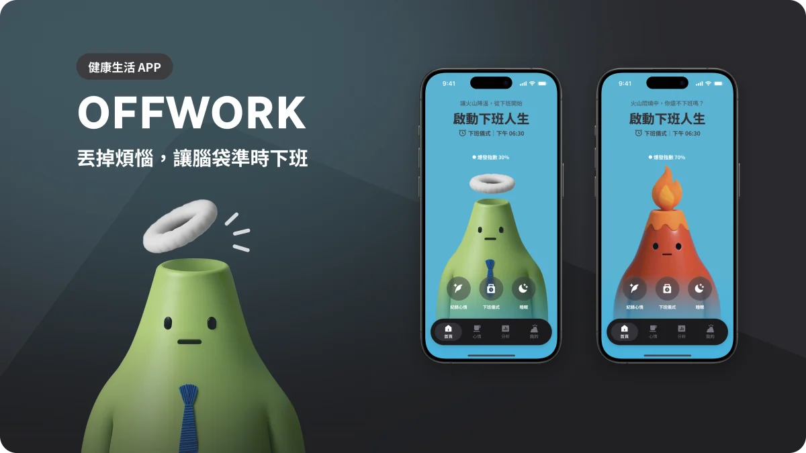

#  OFFWORK APP


[](https://nuxt.com/)
[](https://vuejs.org/)
[](https://tailwindcss.com/)
[](https://gsap.com/)
[](https://vercel.com/)

> 丟掉煩惱，讓腦袋準時下班

## 🎯 專案目標 (Project Goal)

本專案旨在幫助使用者「心理下班」，從工作模式平穩切換到生活狀態

`OFFWORK APP` 由 UI/UX 組成員設計，作為一套「下班儀式引導」，透過語音、書寫與互動模組，幫助使用者切斷工作連結、釋放壓力，建立可持續的「心理下班習慣」

## 👥 團隊成員 (Team Members)

- **UI/UX 設計**: UI/UX 組成員共 6 名
- **前端開發**: 前端組成員共 3 名

## 🌐 線上 Demo (Live Demo)

你可以透過以下連結查看線上 Demo 網站：

[https://offwork.clovetseng.dev/](https://offwork.clovetseng.dev/)

## ✨ 主要功能 (Features)

- **吶喊練習**: 以火山君動畫引導使用者放聲大吼並記錄釋放的時長，達到一個視覺化的情緒釋放體驗。（分貝數目前為示意，尚未串接麥克風）
- **平靜呼吸**: 提供四種引導式呼吸練習——平穩呼吸法、腹式呼吸法、4-7-8 呼吸、4-4-4-4 方格呼吸，依各自的吸氣／憋氣／吐氣節奏帶領使用者在壓力事件後恢復平靜。
- **個人目標設定**: 使用者可以設定每日的呼吸練習與睡眠目標；呼吸時長會被記住，並作為呼吸練習的預設時長。
- **情緒分析**: 透過圖表視覺化呈現使用者的情緒與練習數據。（目前為示範資料）

## 🛠️ 使用技術 (Tech Stack)

- **Frontend Framework**: [Vue3](https://vuejs.org/) | [Nuxt.js 4](https://nuxt.com/)
- **Language**: [TypeScript](https://www.typescriptlang.org/)
- **Styling**: [Tailwind CSS](https://tailwindcss.com/)
- **Animation**: [Lottie](https://lottiefiles.com/)

## 🚀 專案啟動 (Getting Started)

1.  **安裝依賴 (Install dependencies)**:

    ```bash
    npm install
    ```

2.  **啟動開發環境 (Run development server)**:

    ```bash
    npm run dev
    ```

3.  在瀏覽器打開 `http://localhost:3000`
